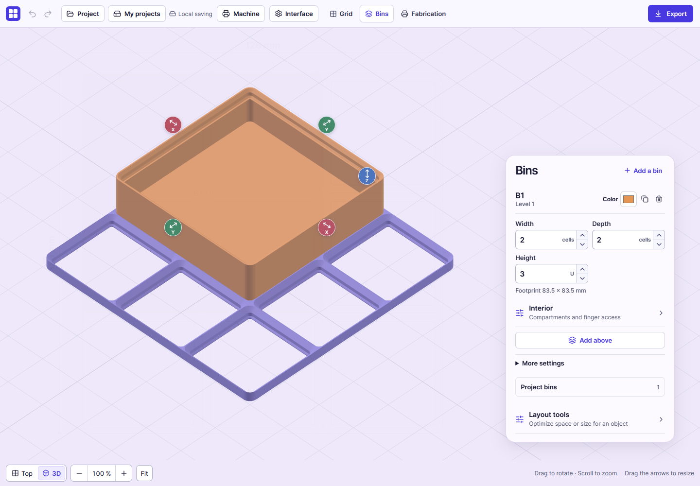
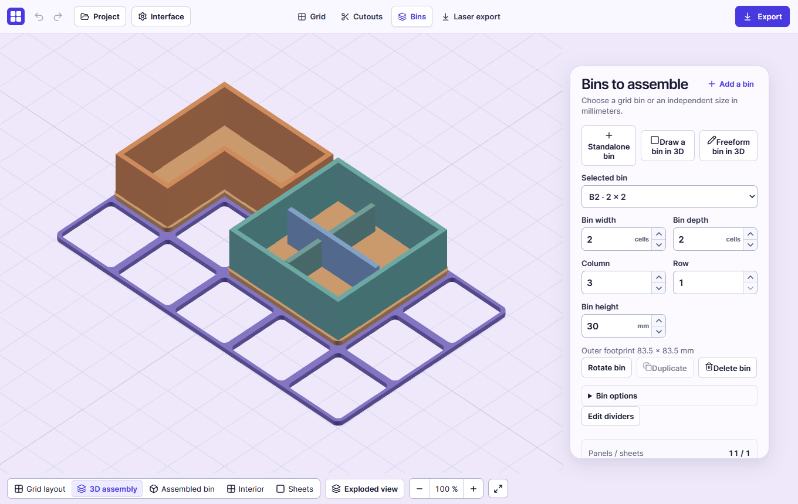
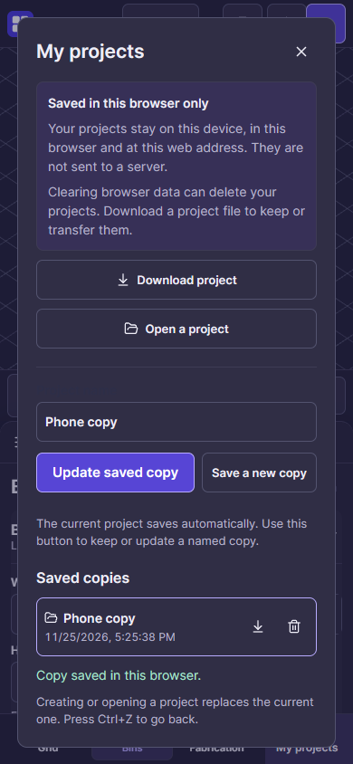

# Ultimate Gridfinity

**[Open the web app](https://la-dosette.github.io/ultimate-gridfinity-web/)**

**[Try the separate reworked preview](https://la-dosette.github.io/ultimate-gridfinity-web/next/)** · The stable release stays at the link above. Preview projects use separate browser storage: download a project from the stable version and open that file in the preview to test a copy.

The preview includes consistent Dimensions / Shape / Assembly inspectors, previous-autosave recovery, complete laser project exports and a physical-height readout verified against downloaded STL geometry. Its source passes 546 automated tests and 10 Chromium interaction scenarios. The full competitor benchmark and physical fit testing remain in progress.

Synthetic test projects: [standard grid and bin](https://la-dosette.github.io/ultimate-gridfinity-web/next/examples/P01.gridfinity.json), [partial cell](https://la-dosette.github.io/ultimate-gridfinity-web/next/examples/P04.gridfinity.json), [unequal supports](https://la-dosette.github.io/ultimate-gridfinity-web/next/examples/P05.gridfinity.json), [S/T/H bins](https://la-dosette.github.io/ultimate-gridfinity-web/next/examples/P06.gridfinity.json), [laser assembly](https://la-dosette.github.io/ultimate-gridfinity-web/next/examples/P09.gridfinity.json).

Design Gridfinity grids, bins and laser-cut storage in your browser. This repository contains the generated web release; the development repository is private.

## Create and export

| Workspace | Tools |
| --- | --- |
| Grid | Grid variants, dimensions, custom corners, cutouts and connectors |
| Bins | Place and stretch bins in 3D, create freeform layouts and stack different footprints |
| Fabrication | Print layout, split large bins, STL/3MF, SVG/DXF, dimensioned drawings and assembly guides |

The app supports 3D printing and laser cutting, saved machine profiles, six interface languages, light/dark themes and mobile layouts. Geometry, previews and export generation run in your browser.

## Your projects stay in your browser

- The current project saves automatically in this browser.
- **My projects** keeps named copies locally, with explicit save, update, open, download and delete controls.
- **Download project** creates a portable JSON backup. Use **Open project** on another device to restore it.
- There are no accounts, Google sign-in, cloud project uploads or online synchronization.

**Browser storage is not a backup.** Clearing site data, private browsing cleanup or browser storage eviction can remove projects. Another browser, device or web address has separate storage. Download your project before changing any of these.

Moving from the previous app address? Download the JSON project at the old address, then open it here. Local browser data does not move automatically between domains.

## Hosting

GitHub Pages serves this static release. No server-side application, database or API keys are required. Public files in this repository are the built application and its illustrations; development sources, server modules, credentials and user projects are not published here.
